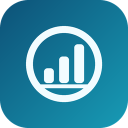

# Regio Energie Smart Meter Import



[![hacs][hacs-badge]][hacs-url]

Home Assistant integration that imports smart meter load profiles from the
customer portal of **Regio Energie Solothurn** (`okp.regioenergie.ch`) and
turns them into long term statistics you can use on the **energy dashboard**.

Electricity, gas, water and district heating meters are supported, in any
combination — configure only the meters you actually have. Optionally it also
imports what that consumption **costs**, with prices that can change from
month to month.

> **Tested with electricity and water only.** Gas and district heating are
> built in and selectable, but nobody has confirmed them against a real
> account yet — the OBIS code or the export type may well differ there. If you
> have such a meter, please
> [open an issue](https://github.com/cybersponge/smart-meter-regioenergie-ha-integration/issues)
> and say whether it worked and which values you used. Same for other Swiss
> utilities: the portal address is a setting, not a constant, so if another
> utility runs the same portal software this should work — reports welcome
> either way.

## How it works

The portal offers the load profile ("Lastgang") as a CSV export. The
integration signs in with your portal account, downloads the most recent values
of each configured meter, aggregates the 15 minute values into full hours and
hands them to the Home Assistant recorder as **external statistics**.

- **History:** a newly added meter first gets its history imported, by default
  the last two years. This runs in the background, one month per request, and
  can take a few minutes; the debug log and the diagnostics show its progress.
- **Polling:** the portal publishes new values every 15 minutes. Every poll
  (default: hourly) reads the last two days; once a day, on the first poll
  after 03:00, the last 7 days are read again to pick up corrections.

A few details are worth knowing:

- The export timestamps the **end** of each interval, so the rows `01:15`,
  `01:30`, `01:45` and `02:00` all belong to the hour `01:00`. The integration
  shifts every timestamp back by 15 minutes before grouping, which is what
  makes the hourly buckets line up.
- Every poll re-reads a window of days and recomputes the running totals on
  top of the last statistic before that window. Values a utility corrects
  after the fact are therefore picked up automatically.
- Hours are bucketed in UTC. The hour that repeats when the clocks go back in
  autumn keeps both of its passes, and the hour skipped in spring leaves no gap.
- The export always covers the full requested range, so its tail is padded
  with empty values for intervals that are not measured yet. Those are skipped
  rather than imported as a consumption of zero, and the hour that is still
  running waits until it has fully elapsed.

The data goes straight into the statistics tables, which is what the energy
dashboard reads. The only entities are the price sensors of priced meters
(see Costs).

## Requirements

Home Assistant 2025.2 or newer, and an account for the web portal of your
utility.

The integration icon is displayed by Home Assistant 2026.3 or newer. Older
versions can still run the integration but do not load locally bundled icons.

## Installation

### Marketplace / HACS

Open the original repository in the Home Assistant Marketplace:

[](https://my.home-assistant.io/redirect/marketplace_repository/?owner=cybersponge&repository=smart-meter-regioenergie-ha-integration&category=integration)

Alternatively, add it manually:

1. HACS → Integrations → ⋮ → **Custom repositories**
2. Add `https://github.com/cybersponge/smart-meter-regioenergie-ha-integration`
   with category **Integration**
3. Install **Regio Energie Smart Meter Import**, then restart Home Assistant

### Manual

Copy `custom_components/regioenergie_import` into your `config/custom_components`
directory and restart Home Assistant.

## Setup

**Settings → Devices & services → Add integration → Regio Energie Smart Meter Import**

1. **Portal account** — portal address (default `https://okp.regioenergie.ch`),
   username (your e-mail address) and password. The login form is discovered
   automatically — on `okp.regioenergie.ch` it lives at
   `/de/services/login.php` — so the three advanced fields only matter for
   portals where that fails (see Troubleshooting).
2. **Meter type** — electricity, gas, water or district heating. The unit and
   the price fields of the next step follow from it.
3. **Meter** — name, meter number, unit, OBIS code, export type and optionally
   the current price (see below). The unit is preset to the one the meter type is
   billed in (`kWh` for electricity, `m³` for water), and `1-1:1.29.0` /
   `WirkBezug` are the defaults used by Regio Energie Solothurn.

You find your meter numbers in the portal under **Lastgang**,
<https://okp.regioenergie.ch/de/services/lastgang.php> — one long identifier
per meter, in the form `CH1000000000000000000000000012345`.

Both the account and the meter are verified against the portal before the entry
is created, so a wrong password or meter number is reported right away.

Further meters, prices, the poll interval and the history are managed under
**Configure** on the integration entry. The portal address and the account
can be changed under **Reconfigure**.

## Energy dashboard

**Settings → Dashboards → Energy**, then add the statistic that matches your
meter:

| Meter type                  | Add it as                                 |
|-----------------------------|-------------------------------------------|
| Electricity                 | Grid consumption                          |
| Water                       | Water consumption                         |
| Gas (untested)              | Gas consumption                           |
| District heating (untested) | Individual device / another energy source |

The statistics are named `regioenergie_import:<name>_import`, for example
`regioenergie_import:water_import`.

Data usually appears with roughly one day of delay — that is how fast the
utility publishes it, not a limitation of the integration.

## Costs

Each meter can have a **price schedule** in the currency configured in Home
Assistant: a list of prices, each valid from a month on.

| Valid from | Price      |
|------------|------------|
| 2025-01    | 0.25 / kWh |
| 2025-10    | 0.28 / kWh |
| 2026-04    | 0.24 / kWh |

A price holds until the next entry, so here February to September 2025 cost
0.25. Months before the first entry use the first price, which means a single
price entered today also prices the imported history.

- Enter the current price when adding a meter, and further entries under
  **Configure → Prices**: pick the meter, then *Add price* (any day of the
  month; only the month counts), *Remove prices* and *Save*.
- After a change the cost history is **re-priced from the first changed
  month on**, from the consumption already stored. The portal is not asked
  again.
- For **water**, add the water and the wastewater price together. That sum
  is the real price per m³. For **electricity**, Regio Energie bills April to
  September at a lower rate and October to March at a higher one, so add an
  entry for each switch.

With a price, the integration imports a **second statistic** per meter,
`regioenergie_import:<name>_cost`, holding the running cost. In the energy
dashboard, pick it in the source's cost setting as **"Use a statistic tracking
total costs"**. Every hour is priced with the price of its own month.

"Use a static price" and "Use an entity with current price" **do not work
here**. Both are computed by an entity that watches the *state* of the
consumption entity, and an external statistic has no entity and no state. That
is why the integration calculates the cost itself.

Each priced meter also gets a sensor, `sensor.<name>_price`, with the price of
the running month (for example `CHF/kWh`) and the whole schedule as an
attribute. It is for display and automations. The dashboard uses the cost
statistic.

## Options

| Option                        | Default | Meaning                                                         |
|-------------------------------|---------|-----------------------------------------------------------------|
| Poll interval (minutes)       | 60      | How often the portal is contacted (15 to 1440).                 |
| Days for the daily correction | 7       | Read again once a day to pick up corrected values.              |
| History of new meters (days)  | 730     | How far back a newly added meter is imported; 0 for none.       |
| Login page / form field names | empty   | Overrides for the login form discovery.                         |

### Importing more history

The action **`regioenergie_import.import_history`** imports a meter's history
from a given start date up to now, in the background. Use it to reach further
back than the initial import did:

```yaml
action: regioenergie_import.import_history
data:
  statistic_id: regioenergie_import:electricity_import
  start: "2023-01-01"
```

If the initial import is interrupted (for example because the portal is
down), the next poll resumes it where it stopped.

## Troubleshooting

**"The portal rejected these credentials, or the login form could not be
found."** — first check the credentials in a browser. If they are correct, the
login form was probably not recognised. Run the bundled probe script from any
machine that can reach the portal:

```bash
python3 tools/probe_portal.py --username YOU --meter YOUR_METER_NUMBER
```

It has no dependencies beyond the standard library and prints the login form it
finds, the field names, and the first lines of the CSV export. Put the reported
values into the advanced login fields of the config flow.

**"The portal returned no readings for this meter."** — the meter number, the
OBIS code or the export type does not match. Compare the number against the
list under <https://okp.regioenergie.ch/de/services/lastgang.php>; the probe
script shows the raw answer of the portal for a given meter.

**Debug logging**

```yaml
logger:
  logs:
    custom_components.regioenergie_import: debug
```

## Known limitations

- Removing a meter deletes its statistics unless you untick *Also delete their
  statistics*. Removing the whole integration entry always deletes them.
- The unit of an existing meter cannot be changed, because its history is
  stored in that unit. Remove the meter and add it again to switch units.
- How far back the portal delivers data is up to the utility. Months without
  data are skipped.

## Development

```bash
python3 -m venv .venv
.venv/bin/pip install -r requirements-test.txt
.venv/bin/python -m pytest
```

The tests cover the CSV parsing, the hourly bucketing (including the daylight
saving changes), the running totals, the history import, the price schedule
and re-pricing, the migration of older entries and the login form discovery.
No portal account is needed.

## Credits

Based on a cron script that read the same export and pushed it into Home
Assistant over the WebSocket API. The CSV parsing and the hourly bucketing are
ported from it.

## License

MIT — see [LICENSE](LICENSE).

[hacs-badge]: https://img.shields.io/badge/HACS-Custom-41BDF5.svg
[hacs-url]: https://hacs.xyz
